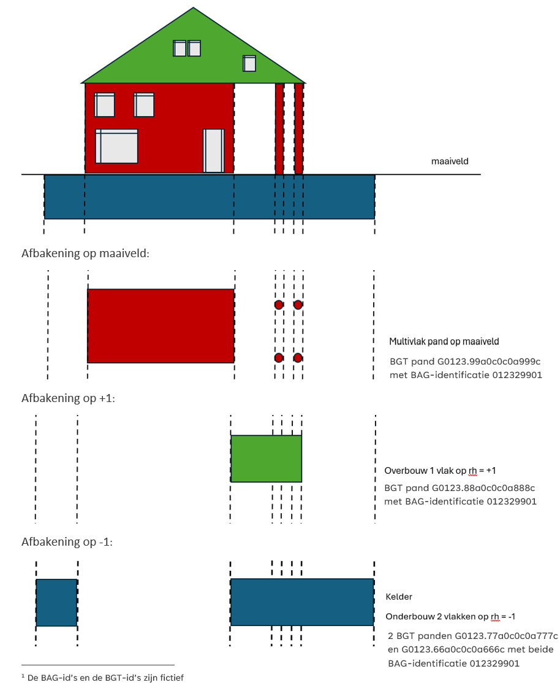
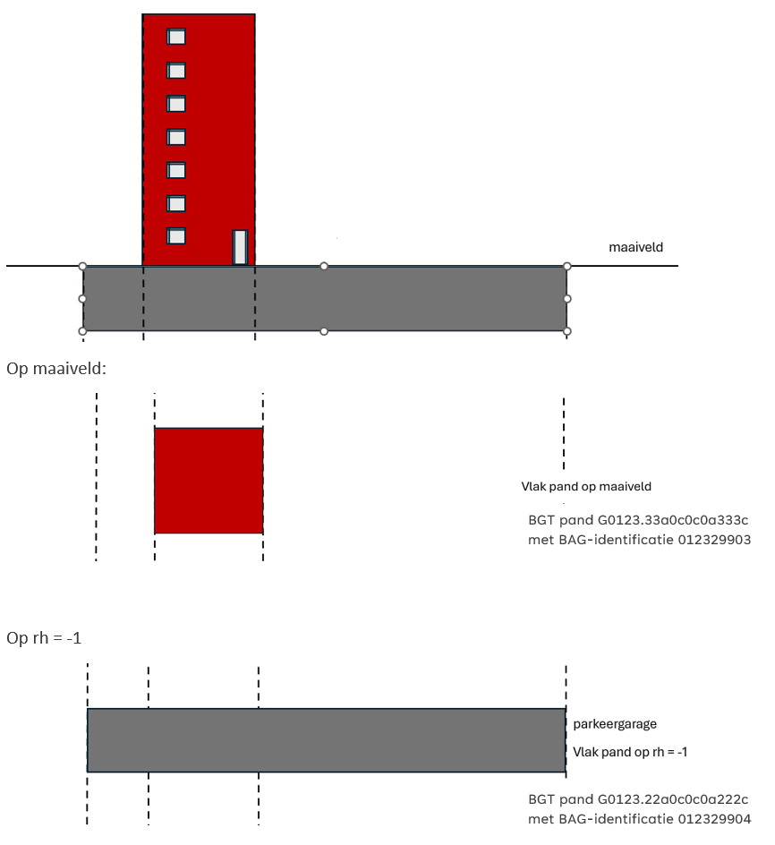
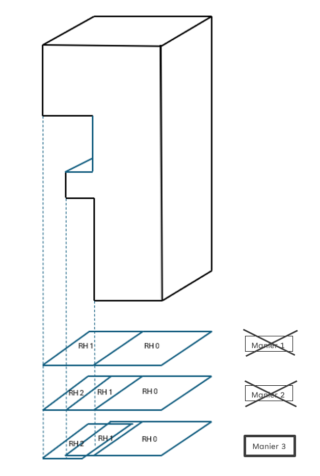
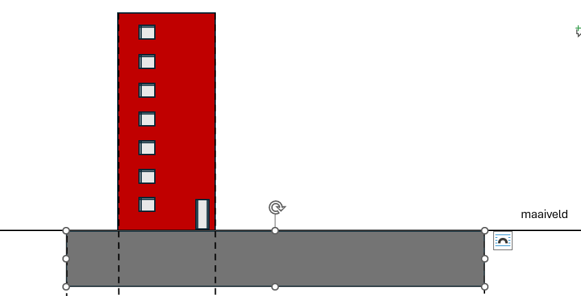
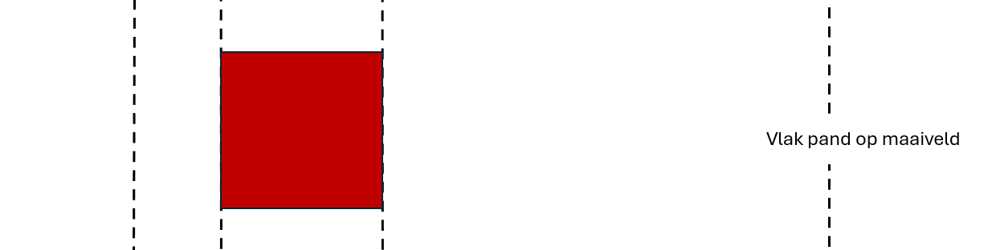
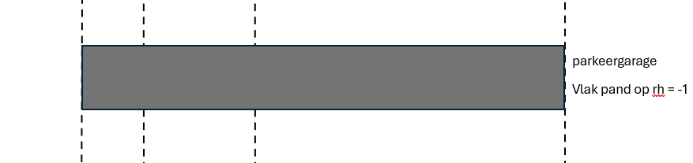

# Bijlage voorbeelden van afbakening[1] De BAG-id’s en de BGT-id’s zijn fictief 
 {#47F5EA8C}
A] Situatie: pand met overbouw en onderbouw (kelder) die groter is dan het pand.  
</img>
Afbakening op maaiveld:   
</img>
</img>
Afbakening op +1:  
</img>
</img>
B] situatie: pand  bestaande uit 2 bovengrondse ingangen (multivlak) en als onderbouw een ondergrondse parkeergarage met dezelfde BAG-identificatie: 1 BAG pand, 2 BGT panden.  
 
 
-178515587

<b>met uitsparingen</b>

BGT pand G0123.44a0c0c0a444c 

met BAG-identificatie 012329902

BGT pand G0123.55a0c0c0a555c 

met BAG-identificatie 012329902

<b>met uitsparingen</b>

BGT pand G0123.44a0c0c0a444c 

met BAG-identificatie 012329902

BGT pand G0123.55a0c0c0a555c 

met BAG-identificatie 012329902

  
 
 
C] situatie van een flat met een grote afzonderlijke en geheel ondergrondse pand (parkeergarage): 2 BAG panden, 2 BGT panden.  
<b>Plaatje heeft word-</b><b>controls</b><b> in beeld:</b>  
</img>
41624251205230

BGT pand G0123.33a0c0c0a333c 

met BAG-identificatie 012329903

BGT pand G0123.33a0c0c0a333c 

met BAG-identificatie 012329903

Op maaiveld:  
</img>
 
 
Op rh = -1  
</img>
 
 
D] Voorbeeld van meerdere overbouwen bij een pand  
In onderstaand voorbeeld is een pand getekend, waaraan 2 overbouw constructies hangen. De afbakening van de geometrie van de overbouwen zou op 3 manieren kunnen plaatsvinden.  
Manier 3 is de enige manier die toegestaan is. <b>Als gegroepeerde vormen:</b>  
-121343060

Manier 3

Manier 2

Manier 1

Manier 3

Manier 2

Manier 1

  
 
 
<b>Overbouw manier 3 als </b><b>png</b><b>:</b>  
</img>
