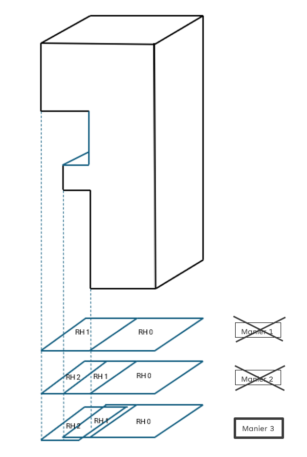

# Bijlage voorbeelden van afbakening1 {#47F5EA8C}

## A] Situatie: pand met overbouw en onderbouw (kelder) die groter is dan het pand. {#4033CD55}
</img>

## B] situatie: pand  bestaande uit 2 bovengrondse ingangen (multivlak) en als onderbouw een ondergrondse parkeergarage met dezelfde BAG-identificatie: 1 BAG pand, 2 BGT panden. {#67869ACD}
</img>

## C] situatie van een flat met een grote afzonderlijke en geheel ondergrondse pand (parkeergarage): 2 BAG panden, 2 BGT panden. {#1EE54FDE}
</img>

## D] Voorbeeld van meerdere overbouwen bij een pand {#73F77CBD}
In onderstaand voorbeeld is een pand getekend, waaraan 2 overbouw constructies hangen. De afbakening van de geometrie van de overbouwen zou op 3 manieren kunnen plaatsvinden.  
Manier 3 is de enige manier die toegestaan is.  
</img>
