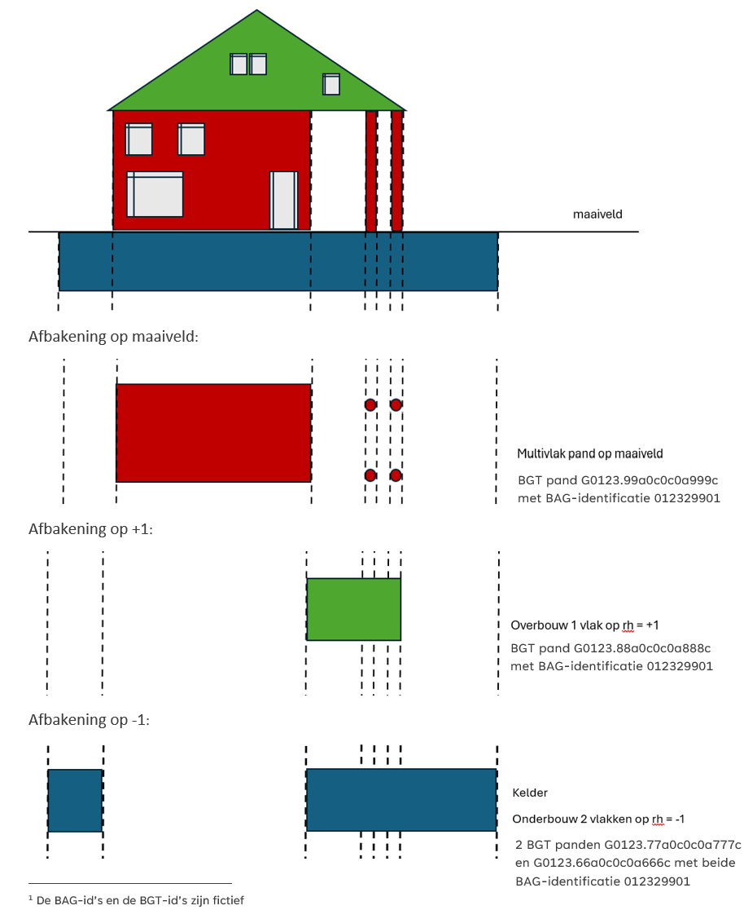
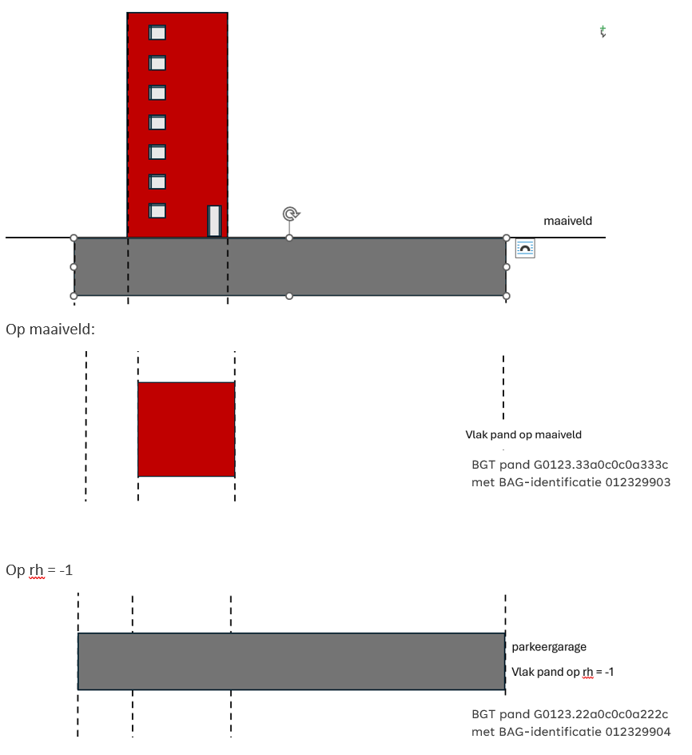

# Bijlage voorbeelden van afbakening[1] De BAG-id’s en de BGT-id’s zijn fictief 
 {#47F5EA8C}
A] Situatie: pand met overbouw en onderbouw (kelder) die groter is dan het pand.  
</img>
B] situatie: pand  bestaande uit 2 bovengrondse ingangen (multivlak) en als onderbouw een ondergrondse parkeergarage met dezelfde BAG-identificatie: 1 BAG pand, 2 BGT panden.  
 
 
</img>
 
 
C] situatie van een flat met een grote afzonderlijke en geheel ondergrondse pand (parkeergarage): 2 BAG panden, 2 BGT panden.  
 
 
</img>
 
 
D] Voorbeeld van meerdere overbouwen bij een pand  
In onderstaand voorbeeld is een pand getekend, waaraan 2 overbouw constructies hangen. De afbakening van de geometrie van de overbouwen zou op 3 manieren kunnen plaatsvinden.  
Manier 3 is de enige manier die toegestaan is.  
</img>
